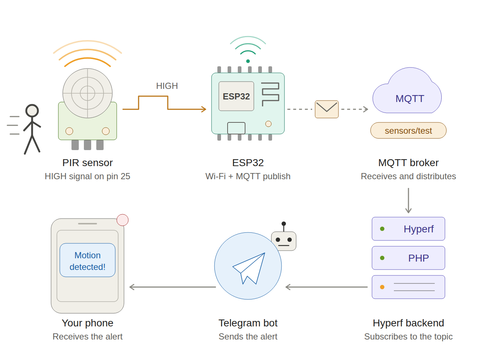
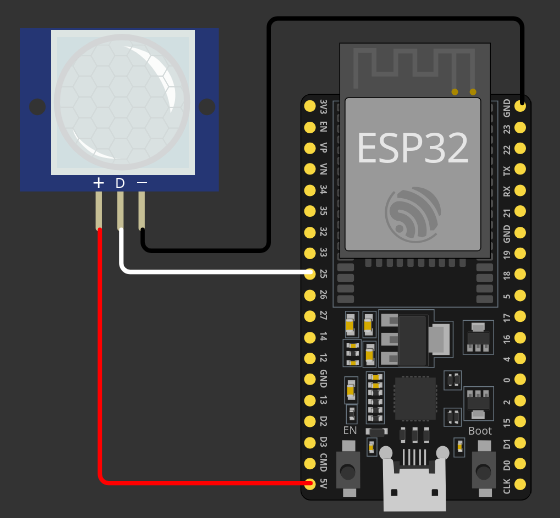

# Motion Detector

demo/pratice-demo.mp4.

A simple prototype that detects motion and sends an alert to a Telegram chat.

## Architecture overview

## Breadboard circuit

## How it works

1. **Detection:** the PIR (Passive Infrared) sensor detects changes in the infrared radiation emitted by warm bodies, such as people and animals. When it senses movement, it sets its signal pin to a logic `HIGH` level.
2. **Reading:** the sensor's signal pin is wired to **GPIO 25** on the ESP32. When the ESP32 sees the `LOW` to `HIGH` transition, it knows motion was detected.
3. **Publishing:** the ESP32 connects to Wi-Fi and publishes a message to the MQTT topic `sensors/test`. MQTT is a lightweight publish/subscribe protocol, which makes it a great fit for asynchronous communication between IoT devices.
4. **Consuming:** a **Hyperf (PHP)** server subscribes to that topic on the broker and consumes the incoming messages.
5. **Alerting:** when a message arrives, the server calls the **Telegram Bot API** (using the token generated by BotFather) and sends a motion alert to a preconfigured chat.

## Future work

- **ESP32-CAM:** evolve the prototype to detect motion and capture a photo of whatever triggered it, sending the image along with the alert.
- **Moving off the breadboard:** once the upgrade is validated, move to a soldered circuit, a custom PCB, and so on.

## Notes

- `wifiClient.setInsecure()` in the firmware disables TLS certificate validation. This is fine for a prototype but should be removed in production.
- PIR sensors usually need 30 to 60 seconds to warm up after power-on and have an adjustable "hold" time during which the pin stays `HIGH`. This can cause odd readings right after startup.
